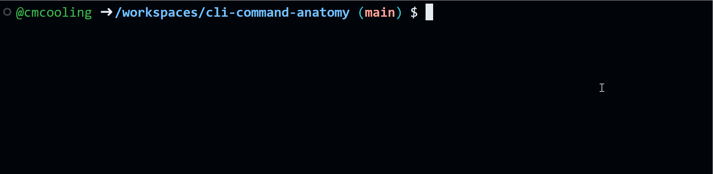

A terminal usually displays a prompt to show it is ready for input. The prompt often includes the current working directory and a symbol such as `$` or `>`. The exact prompt format varies by shell and operating system. A typical prompt might look like this:
    

```bash
/home/user/ $ 
```

A cursor shows where the next character will appear. Users type commands and run them by pressing <kbd>Enter</kbd>.



The above animation shows the process of typing the command `ls`{.bash} and pressing <kbd>Enter</kbd> to execute it. The output of the command is displayed below the command, and a new prompt appears ready for another command.

# Command Structure

A CLI command typically has three parts:

* **Command name:** The action to perform.
* **Options (including flags):** Modifiers that change command behavior. These often start with a single or double dash (for example, `-l`{.bash} or `--long`{.bash}).
* **Arguments:** Values the command uses, such as file or directory names.

A common pattern is:

```bash
command [options] [arguments]
```

Exactly which options and arguments are valid depends on the specific command, but this general structure is common across CLI tools.

# Example

For example, in Bash and zsh, `ls`{.bash} lists the contents of the current directory. In its simplest form, type `ls`{.bash} and press <kbd>Enter</kbd>. It may produce output like this:

```bash
file1.txt file2.txt directory1/
```

Options modify command behavior. For example, `-l`{.bash} makes `ls`{.bash} show more detail for each file or directory:

```bash
ls -l
```

This might produce output like:

```bash
-rw-r--r-- 1 user user 1234 Jan 1 12:00 file1.txt
-rw-r--r-- 1 user user 5678 Jan 1 12:00 file2.txt
drwxr-xr-x 2 user user 4096 Jan 1 12:00 directory1/
```

You do not need to understand every column yet; the key point is that the option changed what the command did and its output.

Arguments tell the command what to operate on. For `ls`{.bash}, we can pass a directory name:

```bash
ls directory1/
```

This lists the contents of `directory1/` instead of the current directory.

Commands can combine options and arguments. For example, we can use `-l`{.bash} and also specify a directory:

```bash
ls -l directory1/
```

This would display detailed information about the contents of `directory1/`.

# Options with Values

Some options require a value. For example, `--output`{.bash} may need a file name to say where output should be saved:

```bash
command --output output.txt
```

Here, `--output`{.bash} is the option and `output.txt`{.bash} is the value provided for that option.
